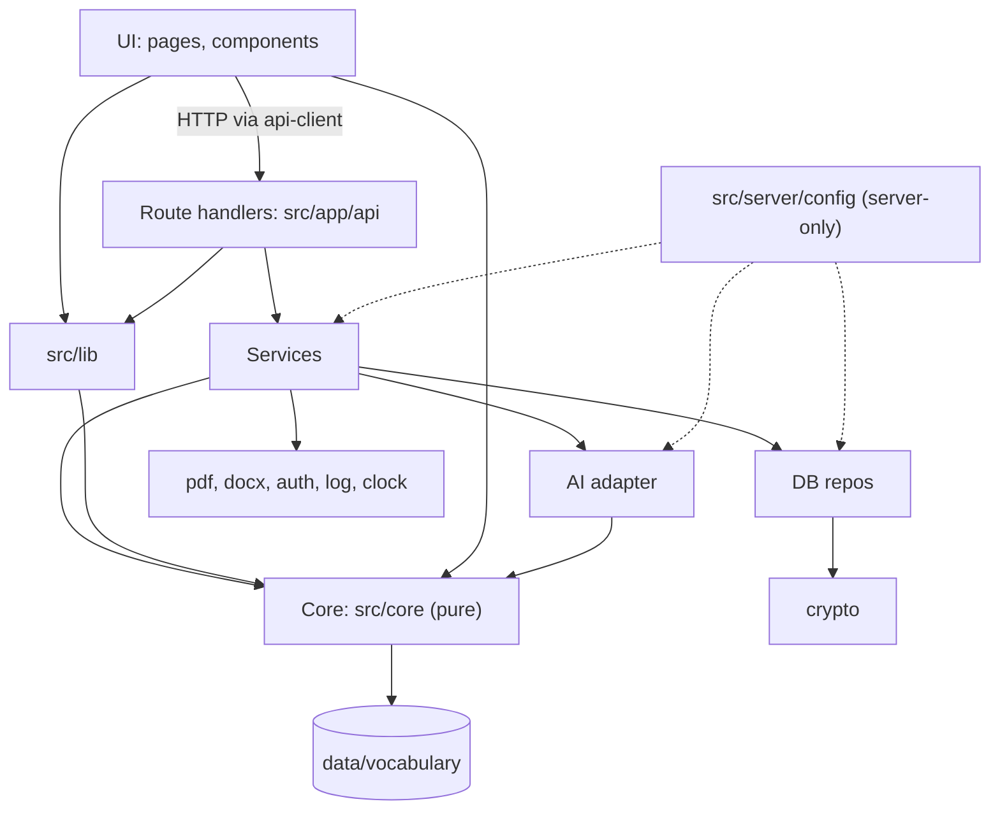
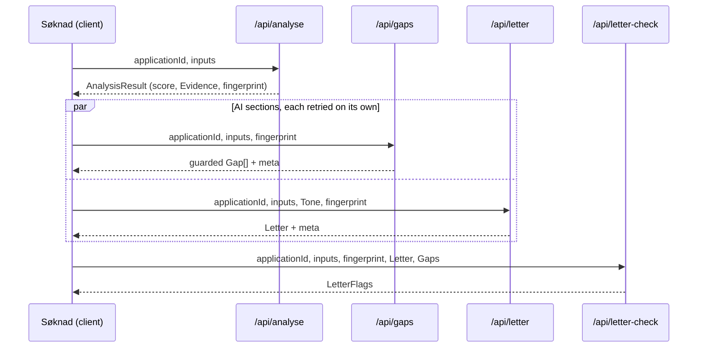
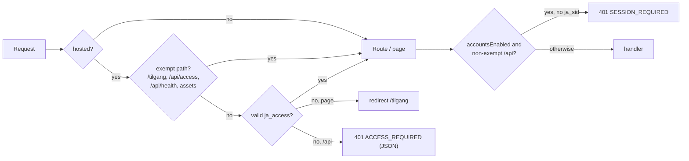
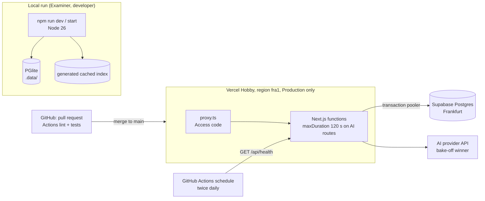
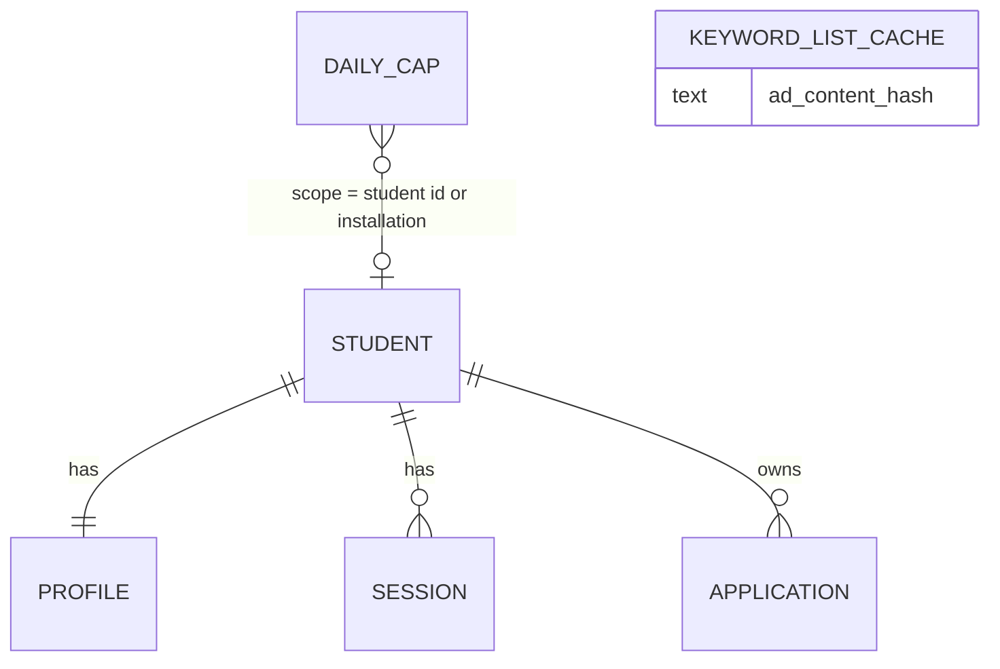

# Architecture Spine: JobAssistant v1

Terms follow the PRD Glossary (§3). Helene confirmed the decisions in the coaching round of 2026-11-08. The reviewer gate added the shared contracts (AD-14 to AD-18). The reasons for every decision are in `.memlog.md`.

## Design Paradigm

**Functional core, imperative shell.** Every product rule (Keywords, Match score, explanations, Integrity guards) lives in a pure TypeScript core with no I/O. A thin server shell does the I/O (HTTP, AI, database, files) through adapters. The UI renders, and calls the API through one client.

| Layer | Directory | Holds | May import |
|---|---|---|---|
| UI | `src/app` pages, `src/components` | Pages Hjem, Søknad, Profil, Historikk, Konto, Tilgang; client components | `src/lib`, pure `src/core` (types, contracts, limits); the server only over HTTP via `src/lib/api-client.ts` |
| Shared lib | `src/lib` | `errors.ts`, `messages.nb.ts`, request schemas, `api-client.ts`, `client-session.ts` | `src/core` |
| Route handlers | `src/app/api/**` | Validate input, call one service, map its `Result` to the error contract | `src/server/services`, `src/lib`, `src/core` |
| Services | `src/server/services` | One use case each: analyse, letter, gaps, letter-check, ai-gateway, keyword-source, profile, history, auth | `src/core`, adapters, `src/server/config` |
| Adapters | `src/server/{ai,db,crypto,pdf,docx,auth,log,clock}` | Talk to the outside world behind an interface | `src/server/config`, `src/core`, `crypto`, `log` |
| Core | `src/core` | Pure functions, zod contracts, message keys, limits, time helpers | only `src/core` and `data/` |



Arrows point from importer to imported. Nothing imports upward, and only server code may import `src/server/*`.

## Invariants & Rules

### AD-1: Core is pure and is the only home of product rules [ADOPTED]

- **Binds:** FR-5–FR-8, FR-11, FR-12 (file name), FR-15, FR-17, FR-25 (day), FR-26, NFR-6
- **Prevents:** scoring, guard or explanation logic leaking into routes or components, where the Fixtures can't test it and two copies drift apart.
- **Rule:** `src/core` imports nothing outside `src/core` and `data/`: no `next`, `react`, `src/server`, AI SDK, DB driver, `node:fs` or network. It is deterministic; time is passed in, and the only day and reset calculations are `core/time.osloDay(now)` and `nextOsloMidnight(now)`. Every product rule named in the PRD is implemented once, in Core. Core decides *which* explanation applies and returns `{ key: MessageKey, params }`. It never returns Norwegian text. `MessageKey` is a string-literal union in `src/core/message-keys.ts`.

### AD-2: One Keyword engine serves the score and every guard [ADOPTED]

- **Binds:** FR-4 (≥3 Keywords), FR-5, FR-6, FR-7, FR-11, FR-15, FR-17, NFR-6
- **Prevents:** the score and the guards disagreeing about whether two words are «the same word», and the FR-5 fallback reaching into Core.
- **Rule:** `src/core/keywords` is the only code that stems, generates compound variants and resolves aliases.
  - **Matching stages**, strictest first: `exact` → `stem` (Snowball Norwegian) → `compound` (split variants of the Keyword only) → `alias`. Only the CV side is inflected, and a Keyword is never shortened, so «ledelse» alone never matches «prosjektledelse».
  - **Two normalisers with different names.** `normalizeForMatch` is used only for matching. `canonicalizeForCitation` (NFC, lowercase, whitespace collapsed, nothing else) is used only by FR-15.
  - **Vocabulary as data.** Single- and multi-word terms, aliases, stop words and Upgrade words are versioned JSON in `data/vocabulary/`, carrying a `vocabularyVersion`. The content is a curated core list, with selected ESCO Norwegian labels as backup.
  - **Extraction.** Core exposes `extractKeywordsCode(ad, vocabulary)` and `acceptProposedKeywords(ad, proposed)`; the second drops any term not found in the ad. The async `KeywordSource` lives in `services/keyword-source` and has two methods:
    - `resolveForAnalyse` may call `proposeKeywords` and cache the result, but only when the FR-5 fallback is on;
    - `resolveReadOnly` uses only a cache hit or code extraction, and never calls AI.

    Code-only lists made because of Test mode, the Daily cap or an AI failure are marked `origin: 'code-degraded'` and are never cached.

### AD-3: Results arrive in two phases, and phase 2 never re-decides phase 1 [ADOPTED]

- **Binds:** FR-8, FR-11, FR-12, FR-21, NFR-4, NFR-5, D19
- **Prevents:** the score waiting on AI or vanishing when AI fails, phase 2 working from a different Keyword list than the one on screen, and extra AI requests.
- **Rule:**
  - **Phase 1.** `POST /api/analyse` returns an `AnalysisResult` (AD-14). It is the only caller of `resolveForAnalyse`.
  - **Phase 2.** Two independent calls, `POST /api/gaps` and `POST /api/letter`, each a separate function with `maxDuration` 120 s. Both call `resolveReadOnly`, recompute the result with Core, and compare it with the `fingerprint` the client echoes back. On a mismatch they return `ANALYSIS_STALE`, and the client reruns phase 1.
  - **Letter check.** `POST /api/letter-check` (pure Core, FR-11) runs whenever a Letter exists: after the first Letter, after «Lag nytt utkast», and after a successful gaps retry. If Gaps are missing, every Missing keyword in the Letter counts as unsupported (FR-11).
  - **Client state and retries.** The client keeps a separate state per section: score, Gaps and Letter. «Prøv igjen» retries only the section that failed, resending the full inputs from the client session (AD-17). The server never rebuilds inputs from a stored Application.



### AD-4: One AI port with live, cached and mock implementations [ADOPTED]

- **Binds:** FR-5 (fallback), FR-9, FR-13, FR-14, FR-16, FR-27, NFR-8
- **Prevents:** provider code spreading through the app, Test mode behaving differently from live, and the Student's name reaching the provider.
- **Rule:** `src/server/ai` exposes one `AiClient` interface: `writeLetter`, `analyseGaps` and, only under the FR-5 fallback, `proposeKeywords`. Each method returns `{ value, meta: AiResultMeta }`. There are three implementations, `live`, `cached` and `mock`, and config alone picks one (AD-11).
  - **Live adapter.** Only `src/server/ai/live` imports a provider SDK, and exactly one SDK is a dependency at delivery. The SDK client is created with automatic retries off (`maxRetries: 0`), and the 90 s timeout is enforced with an `AbortSignal`.
  - **Prompts.** Versioned Norwegian files, `src/server/ai/prompts/<name>@<n>.txt`, and `promptVersion` is `<name>@<n>`.
  - **Gap output.** `analyseGaps` returns `GapAiOutput` (AD-14). A schema-parse failure counts as an AI failure.
  - **Letter sign-off.** Letter prompts require the literal token `{{SIGNATUR}}` exactly once, and the name is never sent to the AI. The UI substitutes the Profile name, or the placeholder before S6, when it renders, copies or builds the .docx.

### AD-5: AI output is guarded before anyone sees it [ADOPTED]

- **Binds:** FR-11, FR-13, FR-15, FR-17, P1, SM-3
- **Prevents:** an unchecked Rewordable gap or suggestion reaching the screen or the database, and the AI choosing what it is checked against.
- **Rule:** The gaps service turns `GapAiOutput` into exactly one guarded `Gap` per `MissingKeyword`, in the same order. Extra AI items are dropped, and Missing keywords the AI skipped become template Real gaps. Each Gap then goes through two guards:
  - **FR-15 citation check.** The citation is checked with `canonicalizeForCitation` against the same CV text that was sent to the AI. A failure downgrades the Gap to a template Real gap.
  - **FR-17 suggestion check.** It runs against the CV entry derived by Core, `entryAround(cvText, citation)`: the blank-line-bounded block, or the single line if the CV text has no blank lines. Any entry text the AI returns is ignored.

  The `guard` field on each Gap records downgrades and discards, which are logged as counts only. FR-11 adds `LetterFlags` and never rewrites the Letter. The client and the database only ever receive guarded output.

### AD-6: One AI gateway owns privacy, cost and logging [ADOPTED]

- **Binds:** FR-23, FR-25, FR-26, NFR-4 (90 s), NFR-8
- **Prevents:** an AI path that skips contact stripping or the timeout, a Daily cap that races past 30 or gives free retries, and prompt text reaching logs.
- **Rule:** Every `AiClient` call goes through `services/ai-gateway`, in this order:
  1. Compute the cached-response key from the original text (AD-16).
  2. Strip email addresses and phone numbers with Core (FR-26).
  3. For a live call, reserve one unit of the Daily cap.
  4. Call the adapter with the timeout.
  5. Write one log event.

  **Daily cap.** A reservation is one atomic upsert on `daily_cap (scope, day)` that increments only while the count is below 30. If no row comes back, the call returns `DAILY_CAP_REACHED` with `resetsAt` and makes no AI request. Reservations are never refunded: timeouts and failures count, every retry and every «Lag nytt utkast» is a new reservation, and `proposeKeywords` counts the same way. When `/api/analyse` meets a reached cap or an AI failure in `proposeKeywords`, it returns success with a `code-degraded` Keyword list, never an error (FR-25). Cached and mock calls skip the reservation.

  **Logging.** `src/server/log` exports only `log(event: LogEvent)`. `LogEvent` is one discriminated union (`ai-call`, `guard`, `request`) whose fields are numbers, enums, ids and `ErrorCode`s. It has no free-text strings.

### AD-7: One request path, with or without accounts [ADOPTED]

- **Binds:** FR-3, FR-18, FR-20, FR-21, PRD §5.1 "Before accounts exist", D20, D22
- **Prevents:** two drifting code paths, and an S6 cut that breaks the core flow.
- **Rule:** Every analysis request carries the inputs it needs: CV text, Job ad, job title, employer and Tone. When `accountsEnabled` is false (AD-18), the server holds no Student data. When it is true, the same handlers require a session and persist through the write model in AD-15, and the CV text comes from the Profile, read-only on Søknad (FR-20, FR-3). Cutting S6 sets `accountsEnabled` to false and removes the persistence calls and the Profil, Historikk and Konto pages. Nothing else changes.

### AD-8: One schema, two Postgres drivers, repositories only [ADOPTED]

- **Binds:** FR-5 (Keyword-list cache), FR-19, FR-20, FR-21, FR-25, FR-30, NFR-7, NFR-9
- **Prevents:** a local database that behaves differently from the hosted one, local data loss, data access that skips the ownership check, and tables exposed by Supabase's own API.
- **Rule:** Drizzle ORM in the Postgres dialect, with one schema (`src/server/db/schema.ts`) and one migration folder. `src/server/db/client.ts` picks the driver from whether `DATABASE_URL` is set, and no other file knows which one is in use.
  - **Hosted: Supabase Postgres in Frankfurt (`eu-central-1`), used as a plain database.**
    - The app connects with `postgres-js` through the transaction pooler (`prepare: false`).
    - Migrations use a separate `MIGRATION_DATABASE_URL`, the session pooler on port 5432.
    - The Supabase Data API is switched off, and row-level security is on for every table with no policies. The app's database role bypasses it.
    - No Supabase Auth, storage or `supabase-js`.
  - **Local: PGlite persisted in `.data/`.**
    - Exactly one PGlite instance per process, kept on `globalThis`.
    - `@electric-sql/pglite` is listed in `serverExternalPackages`.
    - Local migrations run in code at startup, so never run a second process against `.data/` while the app is running. Tests use one in-memory instance per test file.
  - **Repositories.** All queries live in `src/server/db/repos/*`. Every function that touches Student data takes `studentId` first and filters by it. A mismatch returns `null`, which the route maps to 404 (FR-19).

### AD-9: Field-level encryption happens only in repositories [ADOPTED]

- **Binds:** FR-22, FR-29, NFR-7
- **Prevents:** plaintext personal data written by any path, ciphertext reaching services, and scripts that reimplement encryption.
- **Rule:** `src/server/crypto` encrypts with AES-256-GCM from `node:crypto`. The ciphertext format is `v1.<iv>.<tag>.<data>` (base64url), and the key is `ENCRYPTION_KEY`, 32 random bytes in base64. Repositories encrypt on write and decrypt on read through two Drizzle custom types: `encryptedText` and `encryptedJson(schema)`, which parses the AD-14 schema on read.

  Every column falls into one of three classes:
  1. **Personal content, always encrypted:** name, CV text, Job ad, job title, employer, and every column holding Keywords, Evidence, Gaps, suggestions, the Letter or flags.
  2. **FR-22's plain fields:** email (lowercased, unique), dates and the Match score.
  3. **Technical metadata, plain and free of any Student-written text:** ids, `student_id`, password and token hashes, expiry times, counters, `contract_version`, `*_meta` (AiResultMeta), `ai_notice_version` and `keyword_origin`.

  Anything not clearly in class 2 or 3 belongs to class 1. Verdict and Job-ad hashes are never stored on Student rows. Passwords use scrypt from `node:crypto` unless the epic-6 auth library brings its own slow hash. No script writes encrypted columns or password hashes directly; seeding goes through the services (FR-29). There is no key rotation in v1.

### AD-10: Sessions and identity live on the server [ADOPTED]

- **Binds:** FR-9 (sign-off name), FR-18, FR-19, FR-22, NFR-7
- **Prevents:** routes trusting a Student id from the client, the name stored in plain text in auth tables, and two code paths that create Profiles.
- **Rule:**
  - **Sessions.** After S6, sessions are server-side rows referenced by the `ja_sid` cookie (httpOnly, Secure on the Hosted version, SameSite=Lax), with a 30-minute sliding idle expiry.
  - **Identity.** Services resolve the Student id from the session through one `requireSession()` helper, never from the request body or the URL.
  - **Registration.** It creates the `student` row and the `profile` row (with the name, and CV text left empty) in one transaction. The profile service only ever updates that row.
  - **Auth library.** Whichever library epic 6 chooses, its tables store no name (a constant empty string if the column is required), its ids map 1:1 to `student.id`, and its cookie is renamed to `ja_sid`.

### AD-11: One server-only config module decides the run mode [ADOPTED]

- **Binds:** FR-27, FR-30, FR-31, NFR-7, NFR-8, NFR-9
- **Prevents:** scattered environment reads that disagree about the mode, and automated tests that spend money.
- **Rule:** `src/server/config.ts` starts with `import 'server-only'`, reads and zod-validates the environment once, and derives `testMode`, `hosted`, `accountsEnabled` (AD-18) and `isTestRun`.
  - `testMode` is true when there is no AI key, when `TEST_MODE=1`, or when `isTestRun` is true.
  - `isTestRun` is set by the test scripts. The live adapter throws if it is ever constructed while `isTestRun` is true.
  - No other file reads `process.env`, and `NEXT_PUBLIC_*` variables are not used.
  - `npm run setup` writes `.env` only if it doesn't exist, and never overwrites `ENCRYPTION_KEY` or `SESSION_SECRET`. It then runs `db:migrate`, and `db:seed` (only when `DATABASE_URL` is unset). `.env.example` lists every variable without a value.

### AD-12: Fixtures and Cached responses are one shared data set [ADOPTED]

- **Binds:** FR-11, FR-15, FR-17 (guard tests), FR-27, FR-28, SM-2
- **Prevents:** tests and Test mode using different data, stale Cached responses, and Test mode failing in a deployed bundle.
- **Rule:** Each Fixture is a folder, `fixtures/<id>/`, containing:
  - `cv.txt`, and optionally `cv.pdf`;
  - `ad.txt`;
  - `meta.json`;
  - `answer-key.json`;
  - `cached/`: one Letter per Tone, `gaps.json` in `GapAiOutput` form, and `keywords.json` if the FR-5 fallback is on.

  Every cached file carries `AiResultMeta`. A build step, `npm run fixtures:index`, run from `prebuild`, generates `src/server/ai/cached/index.generated.ts`, which maps `pairHash` (AD-16) to the cached JSON. The adapter never reads the file system at runtime. Two CI tests guard the set:
  - every cached file parses against the current schemas and carries the current `promptVersion`;
  - `cv.txt`, the text extracted from `cv.pdf`, and the «Bruk eksempelet» text of each Fixture produce the same `pairHash`.

  Planted bad responses live in `fixtures/_planted/`, and only tests read them.

### AD-13: One error contract, one API client, Norwegian text in one place [ADOPTED]

- **Binds:** FR-1, FR-2, FR-4, FR-18, FR-25, NFR-1, NFR-5
- **Prevents:** each route or the proxy inventing its own error shape, HTML reaching a JSON caller, and English or duplicated wording in the UI.
- **Rule:**
  - **Response shape.** Every response to `/api/*`, including from `proxy.ts`, is `{ ok: true, data }` or `{ ok: false, error: { code, field?, meta? } }`. `ErrorCode` is one closed enum in `src/lib/errors.ts`, with its HTTP status table alongside.
  - **Services.** Services return `Result<T, AppError>` for expected failures and throw only on bugs. Route handlers map anything thrown to `INTERNAL` (500) plus a log event.
  - **Request validation.** Request zod schemas use `ErrorCode`s as their messages.
  - **Norwegian text.** `src/lib/messages.nb.ts` maps every `MessageKey` and `ErrorCode` to text, and a test asserts the map is complete. Responses carry no prose except AI content: `Letter.text`, `Gap.explanation` when its source is `ai`, and `RewordingSuggestion.text`.
  - **API client.** `src/lib/api-client.ts` is the only `fetch` to `/api/*`. It turns a non-JSON response into `NETWORK_ERROR`. On `SESSION_EXPIRED` it saves the client session (AD-17) before going to «Logg inn».

### AD-14: Shared result contracts live in one file [ADOPTED]

- **Binds:** FR-5–FR-8, FR-11, FR-13–FR-17, FR-21, FR-27
- **Prevents:** phase 1, phase 2, letter-check, the UI and the database each inventing their own shapes for Keywords, Evidence and Gaps.
- **Rule:** `src/core/contracts.ts` is the only definition of any type that crosses a layer boundary or is stored. Each type is a zod schema with an inferred TypeScript type, and nothing else declares a look-alike shape. Minimum fields:
  - `Keyword { term, source: 'vocabulary' | 'ai' }`
  - `KeywordList { keywords, origin: 'code' | 'ai-cached' | 'code-degraded', degradedReason?, vocabularyVersion }`
  - `EvidenceCitation { text, start, end }`, with offsets into the original CV text
  - `MatchedKeyword { keyword, stage, evidence }` and `MissingKeyword { keyword, adLine }`
  - `AnalysisResult { keywordList, matched, missing, score, fingerprint }`
  - `GapAiOutput`, the wire shape versioned with the gaps prompt
  - `Gap { keyword, kind: 'rewordable' | 'real', explanation: { source: 'ai', text } | { source: 'template', key, params }, citation?, suggestion?, guard: { downgraded, suggestionDiscarded } }`
  - `Letter { text, tone }`, `LetterFlags`, and `AiResultMeta { source, provider, model, promptVersion, recordedAt? }`

  Verdict is never a field; it is always derived with `core/score.verdictOf(score)`. Every stored JSON value carries `contractVersion`. A contract change is a story of its own and bumps that version.

### AD-15: The Application has one write path per section, and History shows snapshots [ADOPTED]

- **Binds:** FR-12, FR-19, FR-21, NFR-5
- **Prevents:** parallel phase-2 writes overwriting each other, two owners of the score, duplicate Applications on double submit, and old Applications changing after a CV update.
- **Rule:** The `application` table has one column per section, `analysis`, `gaps`, `letter` and `letter_flags`, plus `*_meta` and FR-22's plain fields. The client generates `applicationId` once per submission. Only these writes exist, each a single column-targeted statement filtered by `id` and `student_id`, with no read-modify-write:

  | Handler | Write |
  |---|---|
  | `/api/analyse` | Upsert the row. A repeat with the same fingerprint returns the stored analysis; a different fingerprint returns `ANALYSIS_STALE`. |
  | `/api/gaps` | Set `gaps`. |
  | `/api/letter` | Set `letter`, and set `letter_flags` to null. |
  | `/api/letter-check` | Set `letter_flags`, computed from the Letter and Gaps read from the row. Any Letter or Gaps in the request body are ignored. |

  No other code writes `analysis` or `score`. Reopening from Historikk renders the stored sections exactly as stored and calls no matching, guards or AI. A missing section shows its «not generated» state, and an unchecked Letter shows the «not checked» notice.

### AD-16: One canonical form and one hash for content keys [ADOPTED]

- **Binds:** FR-5 (Keyword-list cache), FR-27, SC8, UJ-3
- **Prevents:** Test mode missing its Cached responses because uploaded, pasted and stored copies hash differently.
- **Rule:** `src/core/text/canonical.ts` owns the canonical form and the hashes.
  - `canonicalizeForHash` applies NFKC, turns CRLF and CR into LF, removes soft hyphens and zero-width characters, rejoins words split by a hyphen at a line break, collapses all whitespace and trims. Case is kept.
  - `contentHash(s)` is the SHA-256 of `canonicalizeForHash(s)`.
  - `pairHash(cv, ad)` is the SHA-256 of `contentHash(cv) + ':' + contentHash(ad)`.

  The cached-response key is `pairHash` of the original, unstripped CV text and the Job ad, computed by the gateway before stripping. The FR-5 cache key is `contentHash(ad)`, from the Job ad text only. The recording script, the index generator and the gateway all import these functions.

### AD-17: One module owns the client session [ADOPTED]

- **Binds:** FR-3, FR-18 (Job ad and unsaved CV draft kept after timeout), FR-20, FR-24, NFR-2, NFR-5
- **Prevents:** pages inventing their own `sessionStorage` keys, stale CV text overriding the Profile after S6, and lost retries after a refresh.
- **Rule:** `src/lib/client-session.ts` is the only code that touches `sessionStorage`. It stores one key, `ja.session.v1`, validated by a zod schema:

  ```
  { v, inputs: { cvText?, cvDraft?, jobAd?, jobTitle?, employer?, tone },
    applicationId?, fingerprint?, phase1?, gaps?, letter?, letterFlags?,
    aiNoticeAccepted?: { version } }
  ```

  Every read falls back to empty on any error. When `accountsEnabled` is true:
  - `inputs.cvText` is never written; `inputs.cvDraft` holds unsaved CV text being edited in Profil, and is cleared on «Lagre» and on «Logg ut» (UX 2026-11-09, WCAG 3.3.7);
  - AI-notice acceptance is stored on the server instead (AD-18);
  - logout clears everything except `jobAd`, `jobTitle`, `employer` and `tone`; session expiry also keeps `cvDraft`. «Logg inn» offers them again, and Profil restores the draft.
  - Session expiry is preceded by a warning dialog two minutes before 30 minutes of inactivity, with «Fortsett økten» renewing the session; any key, pointer or input event counts as activity, and the client renews the session at most once every 5 minutes while active (UX 2026-11-09, WCAG 2.2.1).

  A schema change bumps `v`, and an unknown `v` is discarded.

### AD-18: Run mode and access surfaces [ADOPTED]

- **Binds:** FR-18, FR-24, FR-27, FR-31, NFR-2 (banner), SM-4
- **Prevents:** the Hosted gate blocking the keep-alive or «Logg inn», anonymous AI use after S6, clashing cookies, and the client guessing the run mode.
- **Rule:**
  - **`accountsEnabled`** is a constant in `config.ts`. The S6 story sets it to true, and cutting S6 sets it back to false. When it is true, every `/api/*` route except `/api/health`, `/api/access` and `/api/auth/*` returns `SESSION_REQUIRED` (401) without a session, and the Daily-cap scope is always the Student id. When it is false, no route reads a session, and the scope is `installation`.
  - **The Access-code gate** is `src/proxy.ts`. It is active only when `hosted` is true and covers every path except `/tilgang`, `/api/access`, `/api/health` and static assets. Page requests without access are redirected to `/tilgang`. `/api/*` requests without access get `401 ACCESS_REQUIRED` as JSON.
  - **The `ja_access` cookie** is httpOnly, Secure, SameSite=Lax and lasts for the browser session. Its value is `HMAC-SHA256(SESSION_SECRET, "access:" + sha256(ACCESS_CODE))`, so changing the code revokes it. Registration also checks for a valid `ja_access`. The proxy never reads `ja_sid` and never touches the database.
  - **Run mode on the client.** The root layout (a server component) passes `RunMode { testMode, hosted, accountsEnabled, aiNoticeVersion }` to a client context in `src/components/run-mode.tsx`. Client code reads the run mode only from there.
  - **The AI notice (FR-24)** has a version, `AI_NOTICE_VERSION` in Core, bumped when the provider, the retention period or the FR-5 fallback changes. It is shown before phase 1 whenever `testMode` is false and the stored version differs from the current one. Before S6 the accepted version is kept in the client session. After S6 it is the plain `student.ai_notice_version` column, written by `POST /api/profile/ai-notice`.



## Consistency Conventions

| Concern | Convention |
|---|---|
| Naming in code | English identifiers from the PRD Glossary and AD-14 (`Keyword`, `MatchedKeyword`, `Gap`, `Letter`, `Tone: 'formell' \| 'personlig' \| 'direkte'`, `Application`, `Profile`). UI text is Norwegian, only in `messages.nb.ts`. |
| Files and tests | kebab-case file names; one use case per service file; unit tests next to the code as `*.test.ts`; end-to-end tests in `tests/e2e/`. |
| Traceability | Test names start with the requirement ID, e.g. `describe('FR-7 Match score', …)`. One branch per story, `story/<epic>.<story>-<slug>`, merged by pull request. Commits and pull requests cite story and FR IDs (NFR-10). |
| IDs | `crypto.randomUUID()` text ids. `applicationId` is generated by the client (AD-15). Ownership is always checked (AD-8). |
| Dates and numbers | Stored as UTC `timestamptz`. Display uses `Intl` with `nb-NO` in `Europe/Oslo`: «8. sep. 2026», «71 %». The Daily-cap day comes from `core/time`. |
| Validation | One zod schema per request body in `src/lib/schemas`, used by the form for hints and by the route as the authority. The input limits (2 MB; 200–20,000 and 200–15,000 characters; 200 for title and employer) are constants in Core. |
| Uploaded files | Read into memory, text extracted with `unpdf` (or decoded as UTF-8), then dropped. Never written to disk, stored or served back. |
| Pages and data | Pages are server components that render shells. Søknad, Profil and Historikk use client components that call the API through `api-client`. No Server Actions; Cache Components are off. |
| Design tokens | DESIGN.md colours, type and spacing map to Tailwind v4 `@theme` variables in `src/app/globals.css`. The scaffold's light/dark switching and Geist font are removed: there is one theme, the dark one defined in DESIGN.md, with no toggle (PRD §10). Results regions use `aria-live="polite"`, announced once for the score and once for the AI sections. |
| Frameworks | Only what the scaffold and the Stack list. No state library, RPC layer or component library. |
| Database changes | Edit `schema.ts`, run `npm run db:generate`, commit the SQL, run `npm run db:migrate` locally, and apply it to Supabase with `MIGRATION_DATABASE_URL` before the deploy that needs it. Stories that touch the schema spell these steps out. |
| Dependencies | Exact versions in `package.json` (no `^`); the lockfile is committed. Never `--force` or `--legacy-peer-deps`. `engines.node` is `>=24`; the README recommends 26 LTS. |
| Scripts | Cross-platform npm scripts only (Node scripts, no shell-specific syntax), so they work on Windows, macOS and Linux (NFR-9). `npm test` runs Vitest, then Playwright in Test mode; the README includes `npx playwright install chromium`. |

## Stack

Seed values, checked against the npm registry, the `create-next-app` 16.4.5 source and the Vercel docs on 2026-11-08. After scaffolding, `package.json` owns them.

| Name | Version |
|---|---|
| Node.js (local and Vercel) / npm | 26.x LTS / 11.x |
| Next.js, App Router | 16.4.5 |
| React | 19.3.x |
| TypeScript | 5.9.x (`create-next-app` 16.4.5 installs `^5`) |
| @types/node | 26.x |
| Tailwind CSS | 4.3.x |
| Biome (lint and format) | 2.6.x |
| Drizzle ORM / drizzle-kit | 0.45.x / 0.31.x |
| postgres (postgres-js, hosted driver) | 3.4.9 (v4 is too new for Drizzle 0.45) |
| @electric-sql/pglite (local and tests) | 0.5.x |
| zod | 4.6.x |
| unpdf / docx | 2.1.x / 9.15.x |
| @orama/stemmers (Snowball Norwegian) | 3.1.x |
| AI provider SDK and model | week-47 bake-off winner: Claude Sonnet 5.5 (`@anthropic-ai/sdk` 1.6.x) or an OpenAI model |
| Vitest | 5.1.x |
| Playwright + @axe-core/playwright | 1.65.x + 4.14.x |
| Vercel Hobby, Fluid compute | function region `fra1`; Production deployments only |
| Supabase Postgres (Free, database only) | `eu-central-1` (Frankfurt) |

Scaffold, run once in a temporary folder and moved into the repository root (which `create-next-app` refuses because it isn't empty):

```text
npx create-next-app@16.4.5 jobassistant --ts --app --src-dir --tailwind --biome --import-alias "@/*" --use-npm --no-react-compiler --no-cache-components --no-agents-md
```

Then bump `@biomejs/biome` to 2.6.6, run `npx biome migrate --write`, set `@types/node` to 26.x, pin exact versions, and add `serverExternalPackages: ['@electric-sql/pglite']` to `next.config.ts`.

## Structural Seed

### Deployment and environments



| Environment | Database | AI | Gate | Secrets |
|---|---|---|---|---|
| Local (README) | PGlite in `.data/` | Test mode, unless a key is set | none | `.env` written by `npm run setup` |
| CI (GitHub Actions) | PGlite in memory | mock and cached only (`isTestRun`) | none | none |
| Vercel Production | Supabase | live, with the Daily cap and the provider's monthly spending limit | Access code | Vercel environment variables |

Vercel Preview deployments are switched off.

Operations:
- **Keep-alive (SM-4):** `GET /api/health` is exempt from the gate, never cached (`dynamic = 'force-dynamic'`), and runs one trivial query. It returns 503 if the query fails. A GitHub Actions schedule calls it twice a day and fails on anything but 200. The workflow runs from the first deploy until takedown; check that it is still enabled when grading starts, because GitHub turns off schedules in inactive repositories.
- **Migrations:** run locally at startup and in `npm run setup`. On Supabase, run `npm run db:migrate` with `MIGRATION_DATABASE_URL` before the deploy that needs it.
- **Compliance records** in `docs/qa/`: Supabase's DPA (part of its Terms of Service, so the Free plan is covered), Vercel's DPA and its transfer basis, and the AI provider's DPF status or SCCs, checked before the bake-off.
- **Takedown after grading (FR-23):** the Vercel project, the Supabase project and the keep-alive workflow are removed.

### Core entities



Before S6 only `DAILY_CAP` (scope `installation`) and `KEYWORD_LIST_CACHE` exist; neither holds Student data. `KEYWORD_LIST_CACHE` has no link to Applications (AD-9, AD-16).

### Source tree

```text
jobassistant/
  src/
    app/                # pages (nb), app/api/* handlers incl. health, access, auth
    components/         # UI components, run-mode.tsx
    core/               # pure: keywords/, score/, explain/, guards/, privacy/, text/,
                        #       time/, filename/, contracts.ts, message-keys.ts, limits.ts
    server/
      services/         # analyse, letter, gaps, letter-check, ai-gateway, keyword-source,
                        # profile, history, auth
      ai/               # AiClient: live/, cached/ (index.generated.ts), mock/, prompts/
      db/               # schema.ts, client.ts, repos/
      crypto/  pdf/  docx/  auth/  log/  clock.ts
      config.ts
    lib/                # errors.ts, messages.nb.ts, schemas/, api-client.ts, client-session.ts
    proxy.ts            # Access-code gate (Hosted version only)
  data/vocabulary/      # keywords, aliases, stop words, Upgrade words (versioned JSON)
  fixtures/             # <id>/ per Fixture, plus _planted/
  tests/e2e/            # Playwright: UJ-1 in Test mode, axe scans
  scripts/              # setup.mjs (.env), seed.ts, fixtures-index.ts, record-fixtures.ts
  .github/workflows/    # ci.yml, keep-alive.yml
  docs/qa/              # manual checks, live Fixture outputs, AI-steering index, compliance records
  docs/architecture.md  # architecture rationale for the Examiner
```

## Capability → Architecture Map

| Capability | Lives in | Governed by |
|---|---|---|
| FR-1–FR-4 input | Søknad page, `api/extract`, `server/pdf`, `lib/schemas`, `core/limits` | AD-7, AD-13, AD-17 |
| FR-5–FR-8 Keywords, score, explanation | `core/keywords`, `core/score`, `core/explain`, `services/keyword-source`, `api/analyse` | AD-1, AD-2, AD-3, AD-14 |
| FR-9, FR-10, FR-12 Letter | `services/letter`, `server/ai`, `server/docx`, `core/filename` | AD-3, AD-4, AD-6, AD-15 |
| FR-11 Letter guard | `core/guards/letter`, `api/letter-check` | AD-2, AD-3, AD-5, AD-15 |
| FR-13–FR-17 Gaps, suggestions, guards | `services/gaps`, `core/guards/citation`, `core/guards/suggestion` | AD-2, AD-4, AD-5, AD-14 |
| FR-18–FR-21 accounts, Profile, History | `services/auth`, `services/profile`, `services/history`, `db/repos` | AD-7, AD-8, AD-10, AD-15, AD-18 |
| FR-22, FR-23 storage and logs | `server/crypto`, `db/repos`, `server/log` | AD-6, AD-9 |
| FR-24 AI notice | Søknad page, `api/profile/ai-notice` | AD-17, AD-18 |
| FR-25, FR-26 Daily cap, contact stripping | `services/ai-gateway`, `core/privacy`, `core/time` | AD-6 |
| FR-27–FR-29 Test mode, Fixtures, test user | `server/ai/cached`, `fixtures/`, `scripts/` | AD-4, AD-11, AD-12, AD-16 |
| FR-30, FR-31 hosting, Access code | Vercel `fra1`, Supabase, `src/proxy.ts`, keep-alive workflow | AD-8, AD-18; deployment seed |
| NFR-1 language | `messages.nb.ts`, Norwegian prompts | AD-1, AD-13 |
| NFR-2, NFR-3 accessibility, layout | components, `globals.css` `@theme` | conventions (design tokens) |
| NFR-4, NFR-5 timing, partial results | two-phase API, per-section client state, gateway timeout | AD-3, AD-6, AD-13 |
| NFR-6 determinism | `core/keywords`, exact pins | AD-1, AD-2 |
| NFR-8 cost | gateway reservation, `maxRetries: 0`, `isTestRun` | AD-4, AD-6, AD-11 |
| NFR-9, NFR-11 runnability, maintainability | `scripts/setup.mjs`, PGlite, Biome, this source tree | AD-8, AD-11; conventions |

## Deferred

| Decision | Why it can wait | Decided by, when |
|---|---|---|
| AI provider and model | Weeks 45–46 use no AI. A bake-off on the Example pair and the nursing Fixture (Claude Sonnet 5.5 against one OpenAI model, scored on L1–L8, G1–G3, R1 and the guard results) picks the winner. AD-4 isolates the choice. | Helene, start of S3 (18 Nov; PRD §5.2) |
| AI transfer basis (PRD §8.1) | Before the bake-off, check the contenders on the DPF list. If the winner isn't listed, amend §8.1 to accept Standard Contractual Clauses in the provider's DPA. | Helene, before the bake-off |
| FR-5 fallback on or off | Decided against SM-2 on every Fixture plus a held-out one (PRD §5.2). AD-2, AD-6 and AD-18 already cover both outcomes. | Helene, 17 Nov (PRD FR-5b) |
| Vocabulary contents, and how far compound and paraphrase matching go (FR-6, Open question 6) | AD-2 fixes the format and pipeline; the contents follow the Answer keys. Helene's nursing terms («tverrfaglig samarbeid», «ortopedi», «sykehus», «postoperativ», «smertebehandling») seed the curated list. | Epic 2 |
| Auth library (Better Auth or hand-rolled) | Only epic 6 uses it, and it is cut first. AD-9, AD-10 and AD-18 fix what any choice must meet. | Epic 6 |
| Streaming the Letter | 120 s functions cover NFR-4's 60 s target and 90 s timeout. | Revisit if timed runs fail NFR-4 |
| Building the .docx on the server or in the browser | No other unit depends on it; `{{SIGNATUR}}` substitution is fixed by AD-4. | The FR-12 story |
| Slowing repeated wrong Access-code attempts | A bonus in addendum §2.8. | Epic 1, if cheap |
| Key rotation, backups, monitoring beyond logs | Out of scope for a two-user course app whose data is deleted after grading (FR-23). | Not in v1 |
