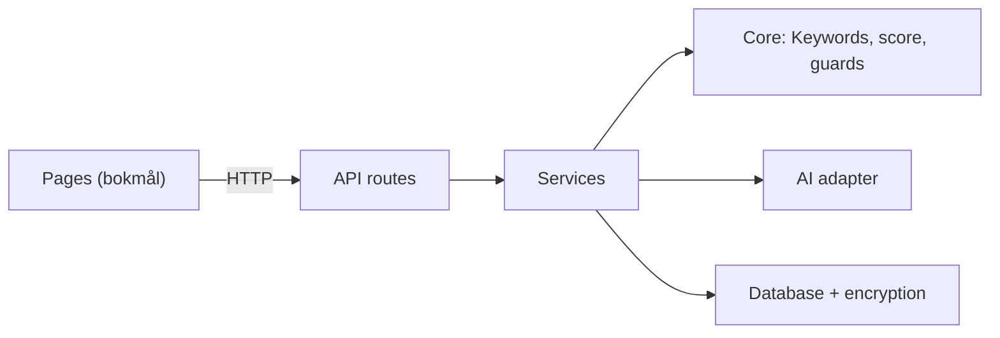

# JobAssistant architecture

This document explains how JobAssistant v1 is built and why. It is written for the IBE160 examiner, and it answers the lecturer's request to justify the choice of language model, storage and encryption (feedback on the product brief, 2026-10-06). Sections 3, 4 and 5 answer that request; sections 1 and 2 give the context they build on.

The binding architecture document for development is the architecture spine, [ARCHITECTURE-SPINE.md](../_bmad-output/planning-artifacts/architecture/architecture-JobAssistant-2026-11-08/ARCHITECTURE-SPINE.md). Its decisions have stable IDs, AD-1 to AD-18, which stories and pull requests cite. Every decision and the alternatives considered are logged in the same folder's `.memlog.md`. Requirement IDs (FR, NFR, SM) and product principles (P1, P2) are defined in the [PRD](../_bmad-output/planning-artifacts/prds/prd-JobAssistant-2026-10-31/prd.md).

## 1. The shape of the app

JobAssistant is one Next.js web app written in TypeScript. It has three layers:

- **Core** (`src/core`): pure functions with no database, network or AI. This is where the product rules live: finding Keywords, calculating the Match score, writing the code-based explanations and running the Integrity guards that check AI output against the CV. Because Core has no I/O, the Fixtures and their Answer keys can test it directly, and the same input always gives the same result (NFR-6).
- **Server** (`src/server`): one service per use case, plus adapters for the AI provider, the database, encryption, PDF reading and the .docx download.
- **UI** (`src/app`, `src/components`): the Norwegian pages. They render results and call the server's API. They compute no product results themselves.

Results arrive in two steps (AD-3). First comes the Match score, calculated by code in well under a second. Then come the Letter and the Gap analysis, from two separate AI requests. If the AI fails or the Daily cap is reached, the score stays on screen, and the Student can retry just the AI part (NFR-5).

## 2. Technology choices

| Area | Choice | Why |
|---|---|---|
| Language and framework | TypeScript, Next.js 16, Node.js 26 LTS | One language and one runtime for pages and server, which keeps the local run simple (NFR-9). Next.js is made by Vercel, the chosen host, and is among the best-documented web stacks for AI-assisted development. |
| Lint and format | Biome | One tool for both (NFR-11). |
| Tests | Vitest (unit and Fixtures), Playwright with axe (end to end and accessibility) | Covers the automated checks in PRD §9.1 with one command. |
| Hosting | Vercel Hobby, functions in Frankfurt | Decided in the PRD (FR-30). The Hobby plan lets a function run for up to 300 seconds, enough for the 90-second AI timeout. |

**Alternative considered:** Python, for its Norwegian text tools. It would mean either two runtimes or a weaker results page, and the strongest Norwegian language-processing models are large downloads that NFR-9 rules out.

## 3. Language model

**Decision:** a small bake-off (a head-to-head test of the two models) at the start of week 47 picks the provider. Claude Sonnet 5.5 (Anthropic) competes against one comparable OpenAI model. Both write a Letter and a Gap analysis for the Example pair and for the nursing Fixture. The outputs are scored on the manual checklist in PRD §9.2 (L1–L8, G1–G3, R1) and on the Integrity guard results. The scores are recorded in `docs/qa/`.

**Why:** the deciding qualities are natural bokmål and strict rule-following. The app must never claim a qualification the CV doesn't support (P1). The two largest providers are the strongest candidates on both counts. Comparing real outputs from our own prompts is a better test than published benchmarks.

**Swappable by design** (AD-4): all AI calls go through one interface with three implementations. The *live* one calls the provider. The *cached* one replays recorded answers for Test mode. The *mock* one is for automated tests. Changing the provider means changing the code in one folder and re-recording the cached answers.

**Without a key:** if no AI key is set, the app runs in Test mode on recorded answers (FR-27). The examiner can run the whole core flow by following the README, at no cost. Automated tests never call a paid AI, even if a key is present (AD-11).

**Data rules** (PRD §8.1): the app uses only a paid API tier that does not train on inputs and has a documented retention period and a data processing agreement. Both contenders process data in the US. Before the bake-off, each is looked up on the EU–US Data Privacy Framework list. If the winner isn't listed, PRD §8.1 is amended to accept the Standard Contractual Clauses in the provider's agreement, and the change is logged.

**Cost** (NFR-8): one Application uses two AI requests, about 10,000 input and 5,000 output tokens in total. With Claude Sonnet 5.5 at 2 USD per million input tokens and 10 USD per million output tokens (November 2026), that is roughly 0.75 NOK per Application. The 200 NOK monthly budget covers about 250 Applications, which is more than development, Fixture runs and the demonstration need. A Daily cap of 30 requests (FR-25), no automatic retries and a monthly spending limit set with the provider keep the cost bounded.

## 4. Storage

**Decision:** PostgreSQL everywhere, with one schema managed by Drizzle ORM (AD-8).

- **Hosted version:** Supabase Postgres, Free plan, in Frankfurt (EU). It is used only as a database: Supabase's login service, file storage and public data API are switched off, because the local run can't have them.
- **Local run:** PGlite, a full Postgres compiled to WebAssembly that runs inside Node.js and saves to a `.data/` folder. It needs no database server and no Docker (NFR-9).

**Why:** the same database engine runs locally and hosted, so the same migrations behave the same way in both places.

**Why Supabase:** the product owner chose Supabase. Neon was the alternative, and the architecture review recommended it for one reason: Supabase pauses Free-plan projects after a week of low activity. To prevent the pause, a scheduled job pings the app's health check twice a day, so the Hosted version stays available during grading (SM-4). Supabase's data processing agreement is part of its terms and covers the Free plan.

**What is stored:** nothing about a Student is stored until accounts and encryption exist (build step 6). Before that, the browser keeps the session, and the server stores only a Daily-cap counter and, if the AI keyword fallback is used, Keyword lists per Job ad. Uploaded CV files are never stored: the text is extracted in memory and the file is discarded (FR-23).

## 5. Encryption and security

**Decision** (FR-22, AD-9): field-level encryption of personal data at rest, with AES-256-GCM from Node.js's built-in `crypto` module and a 32-byte key kept in an environment variable. Encryption happens in exactly one place, the code that reads and writes the database. Every other part of the app works with plain values and can't forget to encrypt. Anyone who opens the database directly sees only ciphertext for the personal fields.

- **Encrypted:** name, CV text, Job ad, job title, employer, Keyword lists, Gaps, suggestions, Letter.
- **Plain text (as FR-22 requires):** email address (needed to log in), dates, Match scores.

**Why field-level, and why this algorithm:** AES-256-GCM is a standard authenticated cipher: it hides content and also detects tampering. It ships with Node.js, so no extra library is needed. Encrypting the whole database disk would not help here, because the hosting provider already does that, and disk encryption would not protect against someone reading the database through the app's own connection.

**Passwords:** stored as salted, deliberately slow hashes (scrypt, built into Node.js). They are never encrypted or stored in plain text.

**Other safeguards:**
- Email addresses and phone numbers are removed from the CV text before any AI request (FR-26).
- Logs record only metadata, never prompt content (FR-23).
- Every database query for Student data is filtered by the logged-in Student, and a request for someone else's data returns "not found" (FR-19).
- The Hosted version is protected by an Access code (FR-31).
- Secrets live only in environment variables (NFR-7).

## 6. Keyword engine

The Match score is calculated by code, never by AI (P2). The engine finds Keywords in the Job ad from a curated vocabulary of skills, tools and domain terms, backed by selected Norwegian labels from ESCO, the EU's skills classification. It then searches the CV for each Keyword in four stages, strictest first:

1. exact match;
2. same word stem (a Snowball Norwegian stemmer, so «prosjektlederen» matches «prosjektleder»);
3. split compounds («prosjekt ledelse» matches «prosjektledelse»);
4. English–Norwegian aliases («agile» matches «smidig»).

The Keyword itself is never shortened, so a CV that says only «ledelse» does not match the Keyword «prosjektledelse» (FR-6). The same engine is used by the Integrity guards, so the score and the guards always agree on what counts as the same word (AD-2).

If a check against the Answer keys at the end of week 46 shows that code alone can't find Keywords well enough, the approved fallback lets AI propose the Keyword list. Matching and scoring stay in code. The engine is built so either path fits without other changes.

## 7. Where things are

| Folder | Contents |
|---|---|
| `src/core` | Product rules: Keywords, score, explanations, Integrity guards |
| `src/server` | Services, AI adapter and prompts, database, encryption |
| `src/app`, `src/components` | Pages and UI components |
| `data/vocabulary` | Keyword vocabulary, aliases, stop words, Upgrade words |
| `fixtures` | Fictional CVs and Job ads with Answer keys and recorded AI answers |
| `tests/e2e` | End-to-end and accessibility tests |
| `docs/qa` | Manual checks, live AI outputs, bake-off results, AI-steering log |
