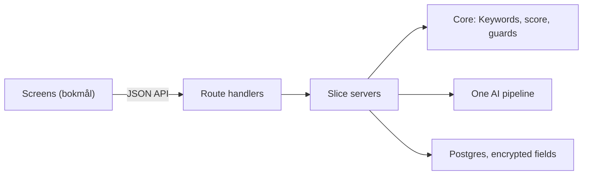

# JobAssistant architecture

This document explains how JobAssistant v1 is built and why. It is written for the IBE160 examiner. It answers the lecturer's request to justify the choice of language model, storage and encryption (feedback on the product brief, 6 October 2026).

**Decisions at a glance**

| Choice | Decision | Details |
|---|---|---|
| Language model | A bake-off on 18 November 2026 picks between Claude Sonnet 5.5 and one OpenAI model, judged on our own checklist and Integrity guards | section 4 |
| Storage | Postgres 17: Supabase in Frankfurt for the Hosted version, a Docker container locally | section 5 |
| Encryption | AES-256-GCM on every personal field, built into Node.js; passwords hashed with scrypt | section 6 |

The binding architecture document for development is the architecture spine, [ARCHITECTURE-SPINE.md](../_bmad-output/planning-artifacts/architecture/architecture-JobAssistant-2026-11-13/ARCHITECTURE-SPINE.md). Its decisions have stable IDs, AD-1 to AD-17, which stories and pull requests cite. Every decision, the alternatives that were weighed and the reviews of the spine are logged in the same folder (`.memlog.md` and `reviews/`). The [PRD](../_bmad-output/planning-artifacts/prds/prd-JobAssistant-2026-10-31/prd.md) defines the requirement IDs (FR, NFR, SM), the product principles (P1, P2), the change IDs (D-numbers), the build steps (§5.1) and the capitalised terms such as Fixture, Answer key and Daily cap (Glossary, §3).

## 1. The shape of the app

JobAssistant is one Next.js web app written in TypeScript (AD-2). Inside it, the code is split into ten feature folders, called slices, under `src/modules/`: `cv`, `keywords`, `match`, `letter`, `gaps`, `integrity`, `ai`, `application`, `identity` and `profile`. Each slice has up to three layers (AD-1):

| Layer | What it holds |
|---|---|
| `core/` | Pure functions with no database, network, AI or clock. The product rules live here: finding Keywords, calculating the Match score and running the Integrity guards. |
| `server/` | The code that talks to the outside world: the database, the AI provider, PDF reading. |
| `ui/` | The Norwegian screens. They show results but compute none themselves. |

The **Integrity guards** are code checks of everything the AI writes, run before the Student sees it (AD-14). They flag a Letter that names a skill the CV doesn't show. They turn a Gap into a Real gap when its quoted CV line isn't in the CV word for word, and they drop a Rewording suggestion that upgrades the Student's role, for example, «forsket» to describe an exam paper.

Because the product rules have no side effects, the Fixtures and their Answer keys can test them directly, and the same input always gives the same result (NFR-6).

Results arrive in two steps (AD-6, D19). First comes the Match score, calculated by code in well under a second. Then the Letter and the Gap analysis come from two separate AI requests, and each appears as soon as it is ready. If the AI fails or the Daily cap is reached, the score stays on screen, and the Student can retry just the part that failed (NFR-5).

## 2. Keyword engine

The Match score is calculated by code, never by AI (P2, AD-5). The language model only writes the Letter and the Gap analysis. The engine finds Keywords in the Job ad from a curated vocabulary of skills, tools and domain terms, backed by selected Norwegian labels from ESCO, the EU's skills classification. It then searches the CV for each Keyword in four stages, strictest first:

1. an exact match;
2. the same word stem («prosjektlederen» matches «prosjektleder»), using the Snowball Norwegian stemmer plus a small rule for noun forms it misses;
3. split compounds («prosjekt ledelse» matches «prosjektledelse»);
4. English–Norwegian aliases («agile» matches «smidig»).

The Keyword itself is never cut down to one of its parts, so a CV that says only «ledelse» doesn't match the Keyword «prosjektledelse» (FR-6). The Integrity guards use the same engine, so the score and the guards always agree on what counts as the same word.

If a check against the Answer keys on 17 November shows that code alone can't find Keywords well enough, the approved fallback in FR-5b lets AI propose the Keyword list. Matching and scoring stay in code. The engine is built so that either outcome fits without other changes.

## 3. Technology choices

The stack began as a reference stack the developer already knew (a Next.js + FastAPI + Postgres web shop, described in `technology.md` in the architecture folder). It was then cut down to what this project's requirements call for and permit.

| Area | Choice | Why |
|---|---|---|
| Language and framework | TypeScript, Next.js 16, React 19, Node.js 26 LTS | One language for screens and server. Next.js is made by Vercel, the chosen host (FR-30). |
| Local run | Docker Compose: the app and a Postgres 17 container (AD-17) | The lecturer runs projects with Docker, so Docker is the only thing the examiner installs (NFR-9). |
| Hosting | Vercel Hobby, functions in Frankfurt | Decided in the PRD (FR-30). A function may run for up to 300 seconds, enough for the 90-second AI timeout. |
| Language model access | Vercel AI SDK, calling the provider directly | see section 4 |
| Database | Postgres 17 everywhere, through Drizzle ORM | see section 5 |
| Encryption | AES-256-GCM and scrypt, from Node.js's built-in `crypto` | see section 6 |
| Styling | Tailwind CSS v4 with the tokens from DESIGN.md | The UX defines its own components, so no component library is used. |
| Lint and format | Biome | One tool for both (NFR-11). |
| Tests | Vitest, and Playwright with axe | All automated checks in PRD §9.1 run with one command in Docker. |

**What was left out of the reference stack, and why:**
- **The separate Python (FastAPI) backend.** It would add a second language and a second service to build, test and host, for no feature this app needs.
- **Redis, a reverse proxy and Railway hosting.** The app has no shared cache to keep, and Vercel already routes requests and provides HTTPS.
- **Payments, email and file storage.** These are not in v1.

**What was kept:** the principle that every outside service has a stand-in when its key is missing. That is how the app runs with no AI key (Test mode, FR-27).

## 4. Language model

**Decision:** a small bake-off on 18 November 2026, at the start of build step 3, picks the provider and model (PRD Open question 3). Claude Sonnet 5.5 (Anthropic) competes against one comparable OpenAI model. Both write a Letter and a Gap analysis for the Example pair and the nursing Fixture. The Gap analysis isn't built until step 4, so the bake-off uses a rough Gap prompt written just for it. The outputs are scored on the manual checklist in PRD §9.2 (L1–L8, G1–G3, R1) and on the Integrity guard results. The scores are recorded in `docs/qa/`, and the winner will be named here.

**Why a bake-off:** what matters most is natural bokmål and strict rule-following, because the app must never claim a qualification the CV doesn't support (P1). Real outputs from our own prompts test both qualities better than published benchmarks do.

**Data rules** (PRD §8.1): only a paid API tier is used, and the provider must not train on inputs, must document its retention period and must offer a data processing agreement. Both contenders process data in the US. Before the bake-off, each is looked up on the EU–US Data Privacy Framework list. If the winner isn't listed, PRD §8.1 is amended to accept the Standard Contractual Clauses in the provider's agreement, and the change is logged.

**Cost** (NFR-8): one Application uses two AI requests, roughly 10,000 input and 5,000 output tokens in total. If the FR-5b fallback is switched on, a new Job ad adds at most one more request. At Claude Sonnet 5.5's price of 2 USD per million input tokens and 10 USD per million output tokens (November 2026), that is about 0.75 NOK per Application. The 200 NOK monthly budget then covers about 250 Applications, more than development, the Fixture runs and the demonstration need. The Daily cap, the absence of automatic retries and a monthly spending limit set with the provider keep the cost bounded.

**Why the Vercel AI SDK:** it calls each provider's API directly, so no extra company handles the Student's text. It also lets the bake-off compare both providers by changing configuration, not code. The losing provider's package is removed afterwards.

**One pipeline for every AI request** (AD-13). Each request goes through the same steps, in a fixed order:
1. The app checks that the Student has accepted the notice that text leaves the app (FR-24).
2. The Daily cap is checked and counted (30 requests a day, FR-25).
3. Email addresses and phone numbers are removed from the CV text (FR-26).
4. The request is sent, with a 90-second timeout and no automatic retries.
5. One log line records the token counts and never the content (FR-23).

**Without a key:** the app runs in Test mode on recorded answers (FR-27). The examiner can run the whole core flow from the README at no cost. Automated tests can never call a paid AI, because the code refuses to (AD-3).

## 5. Storage

**Decision:** Postgres 17 everywhere, with one schema managed by Drizzle ORM (AD-9).

- **Hosted version:** Supabase Postgres, Free plan, in Frankfurt. Supabase's own login service, file storage and public data API are not used. The app connects to Supabase as a plain database, so the same code works locally.
- **Local run:** the official Postgres 17 image, started by the same `docker compose up` as the app (AD-17). On first start, the app creates its own local secrets, prepares the database and adds the README test user.
- **Automated tests:** PGlite, which is Postgres 17 compiled to run inside Node.js, so the tests need no database server.

**Why Postgres in both places:** the same database version runs locally and hosted, so the same migrations behave the same way in both. The tests use PGlite for speed, but every pull request also starts the app once against real Postgres in Docker, so a difference between the two shows up before merging. An earlier plan used a file database locally instead of Docker; it was dropped when the local run moved to Docker.

**Why Supabase:** it offers a free Postgres database in an EU region. Neon, the other free EU option considered, would have worked as well; Supabase was the product owner's choice. Supabase's data processing agreement is part of its terms. Whether it covers the Free plan is checked when the database is set up and recorded in `docs/qa/`; if it doesn't, the README run becomes the delivery (PRD §5.1). Supabase pauses a Free project after seven days without activity, so a scheduled job pings the app's health check twice a day. That keeps the Hosted version available during grading (SM-4).

**What is stored:** nothing about a Student is stored until accounts and encryption exist (build step 6). Until then, the CV text and the results live only in the browser tab. The server stores just the Daily-cap counter and, if the AI keyword fallback is used (FR-5b), Keyword lists per Job ad. Uploaded CV files are never stored: the text is extracted in memory and the file is discarded (FR-23). The CV text is kept once, in the Profile, and never copied into each saved Application.

## 6. Encryption and security

**Decision** (FR-22, AD-11): personal fields are encrypted in the database with AES-256-GCM, from Node.js's built-in `crypto` module, using one 32-byte key. Encryption happens in one place only: the database column types that every data-access module must use. Anyone who opens the database directly sees only ciphertext for the personal fields.

- **Encrypted:** name, CV text, Job ad, job title, employer, the analysis (its keyword lists and Evidence), Gaps, Rewording suggestions and the Letter.
- **Plain text:** the email address (needed to log in), dates, Match scores and technical values such as IDs and counters. The shared Keyword lists per Job ad from section 5 also stay plain, because they hold no Student data; FR-22's "keyword lists" means the ones inside each analysis.

**Why field-level encryption, and why this algorithm:** AES-256-GCM is a standard authenticated cipher, which means it both hides the content and detects tampering. It ships with Node.js, so no extra library is needed. Encrypting the whole disk would add nothing here: the hosting provider already does that, and it wouldn't protect against someone reading the database through the app's own connection.

**Passwords** are stored as salted, deliberately slow hashes (scrypt, built into Node.js). They are never encrypted or stored in plain text.

**Other safeguards:**
- Every query for Student data is filtered by the logged-in Student, and a request for someone else's data answers "not found" (FR-19, AD-10).
- Sessions end after 30 minutes without activity. The Student is warned two minutes before, as WCAG 2.2.1 requires (FR-18, AD-12).
- The Hosted version is closed with an Access code (FR-31). The app refuses to start on Vercel if the code or other required settings are missing (AD-3).
- Secrets are never committed (NFR-7). On the Hosted version they are Vercel environment variables. Locally, the encryption key is generated on first start into a secrets file in a Docker volume; only the app's configuration code reads that file.

## 7. How it runs

| Where | How |
|---|---|
| The examiner's machine | `docker compose up --build`, then open `http://localhost:3000`. It runs in Test mode with no key. `docker compose run --rm --build test` runs every automated test. |
| Hosted version | Vercel builds the app from `main` and deploys only that branch. The database is Supabase in Frankfurt, and the Access code is handed in with the submission. |
| Every pull request | GitHub Actions runs the same Docker test command, checks the database migrations and starts the app once against real Postgres. A story is merged only when this passes. |

## 8. Where things are

| Folder | Contents |
|---|---|
| `src/modules/<slice>` | The ten feature slices, each with its `core`, `server` and `ui` code |
| `src/shared` | Code used by every slice: configuration, database, encryption, logging, the API client and the Norwegian UI texts |
| `src/app` | Pages and API routes |
| `data/vocabulary` | The Keyword vocabulary and aliases |
| `data/fixtures` | Fictional CVs and Job ads with Answer keys and recorded AI answers |
| `drizzle` | Database migrations |
| `scripts` | Setup, migration and the checklist helper |
| `e2e` | End-to-end and accessibility tests |
| `docs/qa` | Manual checks, live AI outputs and bake-off results |
| `.github/workflows` | The pull-request checks and the twice-daily keep-alive job |
| `Dockerfile`, `compose.yaml` | The local run |
